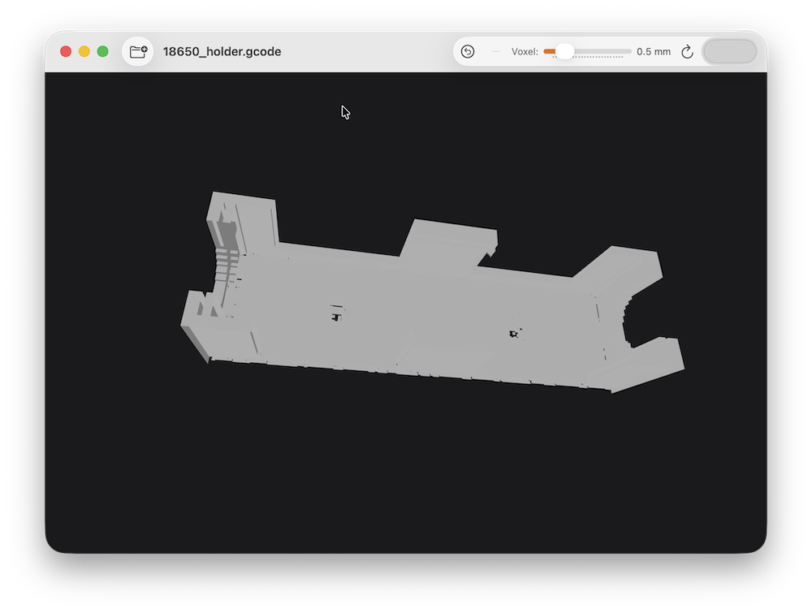

# GCode Viewer

gcodeViewer is a native macOS app that parses `.gcode` files and renders an interactive 3D surface mesh of the printed object — showing only the **outer shell**, with no internal infill or travel moves visible. It uses voxel-based shell extraction, so any slicer's output can be viewed without slicer-specific parsing. Two Quick Look extensions bring the 3D view directly into Finder without launching the app: an interactive Space-bar preview you can rotate and zoom, and 3D file icons.



## Features

- **Surface-only rendering** — infill, inner walls and closed voids are filled solid; only the outer surface is meshed
- **Smooth mesh** — Marching Cubes with averaged normals instead of blocky voxels
- **Fast** — 3DBenchy loads in 7 ms at 0.5 mm and 38 ms at 0.1 mm (Apple M2), using all cores
- **Interactive Quick Look preview** — press Space on a `.gcode` file in Finder and rotate, pan and zoom the model right there, with the same controls as the app
- **Quick Look thumbnails** — Finder icons show the printed object instead of a text page
- **Interactive 3D viewport** — orbit around the vertical axis, pan, zoom and standard views with mouse, trackpad or keyboard
- **Adjustable voxel resolution** — trade detail for speed (0.1–2.5 mm); very large models are coarsened automatically
- **Colour picker** — change the object colour without re-processing the file
- **Drag & drop, Open With** — registered as a viewer for `.gcode` files system-wide
- **Arc support** — `G2`/`G3` in I/J and R form
- **Start G-code suppression** — purge and prime lines before the slicer's first layer marker are hidden
- **Persistent settings** — voxel size, object colour and window position/size are remembered
- **No dependencies** — Apple frameworks only (SwiftUI, SceneKit, Metal, Quick Look, simd)

## Requirements

| | |
|---|---|
| macOS | 14 Sonoma or later |
| Architecture | Apple Silicon only |
| Xcode (to build) | 26 or later (Swift 6.2 compiler, Swift 5 language mode) |

## Installation

### Build from source

```bash
git clone https://github.com/dirkclemens/gcodeViewer.git
cd gcodeViewer
./build-release.zsh
```

`build-release.zsh` builds the Release configuration, installs it to `/Applications/gcodeViewer.app` and registers both Quick Look extensions with macOS (see [Quick Look](#quick-look)).

For development, open `gcodeViewer.xcodeproj`, select the **gcodeViewer** scheme and **My Mac**, and press **⌘R**. No package manager or third-party dependencies are required.

### Prebuilt DMG

A ready-to-run build is available as `gcodeViewer.dmg` (ad-hoc signed, Apple Silicon only). Since it isn't notarized by Apple, macOS blocks it on first launch. Copy the app to `/Applications`, then remove the quarantine flag:

```bash
xattr -dr com.apple.quarantine /Applications/gcodeViewer.app
```

Alternatively, right-click the app in Finder and choose "Open". Launch the app once so macOS registers its Quick Look extensions.

---

## Usage

1. Launch the app.
2. Open a file via **File › Open…** (⌘O), the toolbar button, by dragging a `.gcode` file onto the window or the Dock icon, or via Finder's **Open With**.
3. Parsing, voxelising and meshing run in the background; progress is shown as an overlay.
4. The status capsule at the bottom left shows the triangle count and the effective voxel size.

### Camera Controls

| Input | Action |
|---|---|
| Left drag | Orbit — horizontal movement turns the model around its vertical axis, vertical movement tilts |
| Option + drag | Orbit (Maya convention) |
| Right drag / Shift + drag | Pan |
| Ctrl + drag | Dolly (drag up = closer) |
| Scroll wheel / trackpad | Zoom |
| Shift + scroll | Pan |
| Ctrl + scroll | Pan horizontally |
| ⌘← / ⌘→ | Orbit left / right in 15° steps |
| ⌘↑ / ⌘↓ | Tilt up / down in 15° steps |
| ← → ↑ ↓ | Pan |
| `+` / `-` | Zoom in / out |
| `F` | Frame the object / reset camera |
| `1` / ⌘`1` | Front / back view |
| `3` / ⌘`3` | Right / left view |
| `7` / ⌘`7` | Top / bottom view |

### Toolbar

| Control | Description |
|---|---|
| **Open…** | Open a `.gcode` file |
| **Reset Camera** | Return to the default view |
| **Voxel** slider | Mesh resolution (smaller = more detail, slower); applied on the next load |
| **Reload** | Re-process the current file with the current voxel size |
| **Colour** picker | Change the object colour (instant, no reload) |

## How It Works

```
.gcode file (memory-mapped)
    │
    ▼  GCodeParser       byte-level parser → moves + estimated layer height / line width
    │                    G0/G1/G2/G3/G28/G90/G91/G92/M82/M83
    │
    ▼  SurfaceExtractor  3-D DDA into a bit-packed voxel grid (64 voxels per word),
    │                    thickened to the real bead size, cavities filled → solid volume
    │
    ▼  MeshBuilder       multi-core Marching Cubes ("Flying Edges") → smooth mesh
    │
    ├─▶ App              SceneKit scene + reference grid, custom Z-up camera controls
    ├─▶ QL preview       the same interactive viewport inside the Quick Look panel
    └─▶ QL thumbnail     offscreen SceneKit render → Finder icon
```

- **Shell extraction without slicer knowledge.** Every extruding move is rasterised into the voxel grid and widened to the bead size estimated from the file (extruded volume per millimetre of travel), so neighbouring lines merge into closed walls at any voxel size. A flood fill then marks all space reachable from outside; everything else — infill, inner perimeters, closed voids — becomes solid and produces no triangles.
- **Bit-parallel.** All volume passes work on whole 64-bit words; the cavity fill spreads through runs of empty cells with a single addition per word.
- **No hash maps.** The mesh builder counts vertices and triangles first, then writes them straight to their final position on all cores; shared vertices are found by popcount.
- **Start G-code** before the first layer marker (`;LAYER:0`, `;LAYER_CHANGE`, `; CHANGE_LAYER`) is ignored, so purge lines neither show up nor shrink the model in the view.
- **Memory cap.** The grid is limited to 10⁹ voxels (125 MB); larger models get a coarser voxel size automatically, shown in the status capsule.

## Quick Look

| Extension | Shows up in | Details |
|---|---|---|
| `gcodeViewerQL` | Space-bar preview, Quick Look panel | **Interactive** 3D view with grid — drag to orbit, right-drag/Shift-drag to pan, scroll to zoom, `F` to reset; 0.5 mm voxels |
| `gcodeViewerQLThumbnail` | Finder icons, column view, Get Info | Static image, transparent background; 0.8 mm voxels for icons up to 128 pt, 0.5 mm above |

Both run in sandboxed processes and use the same pipeline as the app. The preview hosts the app's own 3D viewport inside the Quick Look panel; thumbnails are rendered offscreen with SceneKit/Metal, with the camera fitted to the corners of the object's bounding box. A thumbnail of 3DBenchy takes about 17 ms. The object colour is fixed (the extensions cannot read the app's settings). Keys the Quick Look panel uses itself (Space, Esc) are not available to the 3D view.

### Activation

`./build-release.zsh` registers both extensions and removes stale registrations (Xcode build folders, archives) that could otherwise be used instead of the installed app. The Space-bar preview works immediately.

If Finder still shows the plain-text icon after the first install, log out and back in once: macOS's thumbnail service keeps its list of extensions from login and cannot be restarted otherwise. Both extensions can be checked in *System Settings › General › Login Items & Extensions › Quick Look*.

Check the registration from Terminal:

```bash
pluginkit -m -A -v -i de.adcore.gcodeViewer.gcodeViewerQLThumbnail   # should list /Applications/… only
qlmanage -t -x -s 256 -o /tmp test_cube.gcode                        # writes /tmp/test_cube.gcode.png
```

Running the app from Xcode registers the Xcode build again; run `./build-release.zsh` afterwards to make the installed version the active one.

### UTType note

`.gcode` is not an Apple-defined type. Some applications (e.g. Pleasant3D) register `com.pleasantsoftware.uti.gcode` for this extension. This app exports its own `de.adcore.gcode` type and imports `com.pleasantsoftware.uti.gcode`, so Quick Look and Finder integration work regardless of which app registered the type first.

## Project Structure

```
Info.plist                        # App plist: UTTypes, document types
build-release.zsh                 # Release build → /Applications → Quick Look registration

gcodeViewer/
├── gcodeViewerApp.swift          # @main entry point, AppDelegate, window frame persistence
├── ContentView.swift             # Root SwiftUI view, toolbar, drag & drop, overlays
├── UpdateChecker.swift           # Version check (currently log only)
├── Model/
│   ├── AppState.swift            # Load pipeline, settings, scene assembly
│   ├── Move.swift                # Move + ParsedGCode (bead estimate)
│   └── Color+Hex.swift           # Color ↔ "#RRGGBB" helpers
├── Parser/
│   └── GCodeParser.swift         # Byte-level G-code parser
├── Geometry/
│   ├── SurfaceExtractor.swift    # Voxelisation, thickening, cavity fill
│   ├── MeshBuilder.swift         # Parallel Marching Cubes → MeshData / SCNGeometry
│   ├── SceneBuilder.swift        # Mesh + grid + light → SCNScene (app and preview)
│   └── GridBuilder.swift         # Reference grid
└── Views/
    ├── GCodeSCNView.swift        # 3D viewport: camera controls, framing, lights (app and preview)
    └── SceneKitView.swift        # SwiftUI wrapper

gcodeViewerQL/
├── PreviewViewController.swift   # Interactive Space-bar preview
├── GCodeSnapshotRenderer.swift   # Offscreen SceneKit → CGImage (thumbnails)
└── Info.plist

gcodeViewerQLThumbnail/
├── ThumbnailProvider.swift       # Finder icons
└── Info.plist
```

## Performance

Measured on an Apple M2, Release build, complete pipeline (parse + voxelise + mesh):

| File | Voxel size | Time | Triangles |
|---|---|---|---|
| 3DBenchy (2.9 MB) | 0.5 mm | 7 ms | 97 k |
| 3DBenchy (2.9 MB) | 0.1 mm | 38 ms | 2.4 M |
| 16 × 3DBenchy (46 MB, 1.5 M moves) | 0.5 mm | 0.11 s | 1.6 M |
| 16 × 3DBenchy (46 MB, 1.5 M moves) | 0.2 mm | 0.19 s | 11 M |

## Known Limitations

- Line width is estimated assuming 1.75 mm filament; with 2.85 mm filament walls appear thicker.
- Multi-material prints are shown as one object in one colour; tool changes are ignored.
- Supports, brims and skirts are rendered like the object.
- Details smaller than the voxel size are lost.

## Possible Future Enhancements

- Share the object colour with the Quick Look extensions
- Layer-by-layer animation with a time slider
- Colour mapping by layer, print speed or tool
- Cross-section clipping plane
- Mesh export (STL / OBJ / 3MF)
- Multi-extruder / multi-colour support

---

## License

This project is licensed under the [PolyForm Noncommercial License 1.0.0](https://polyformproject.org/licenses/noncommercial/1.0.0) — see [LICENSE](LICENSE) for details. Free for noncommercial use; commercial use requires a separate license from the author.
